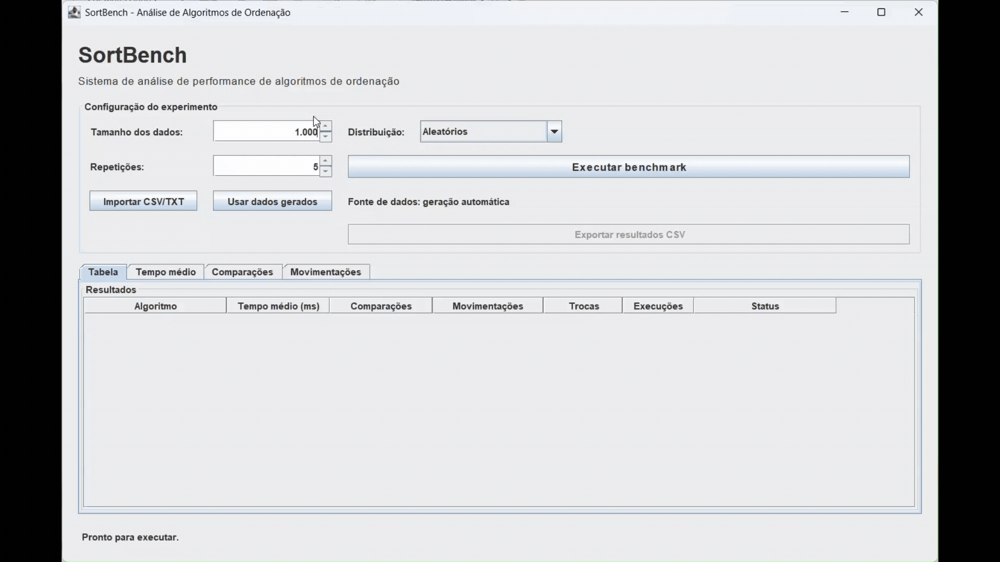
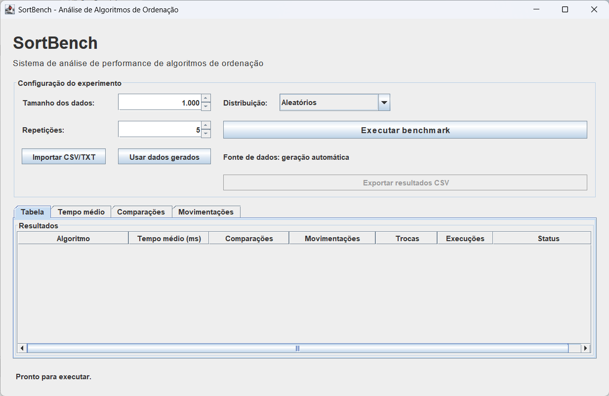
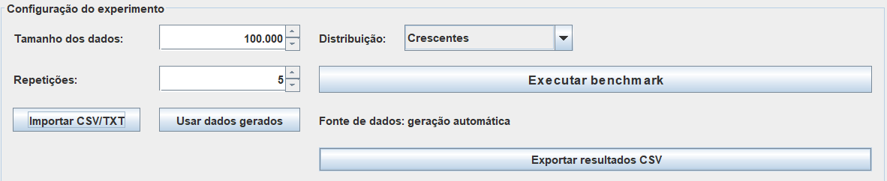
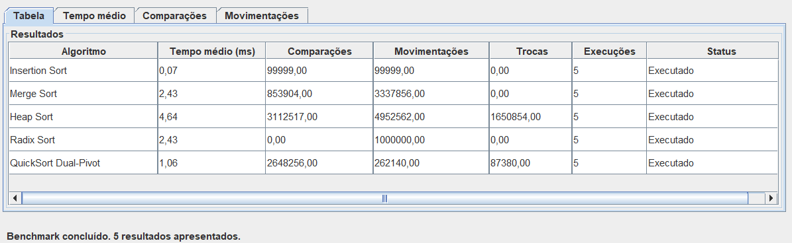
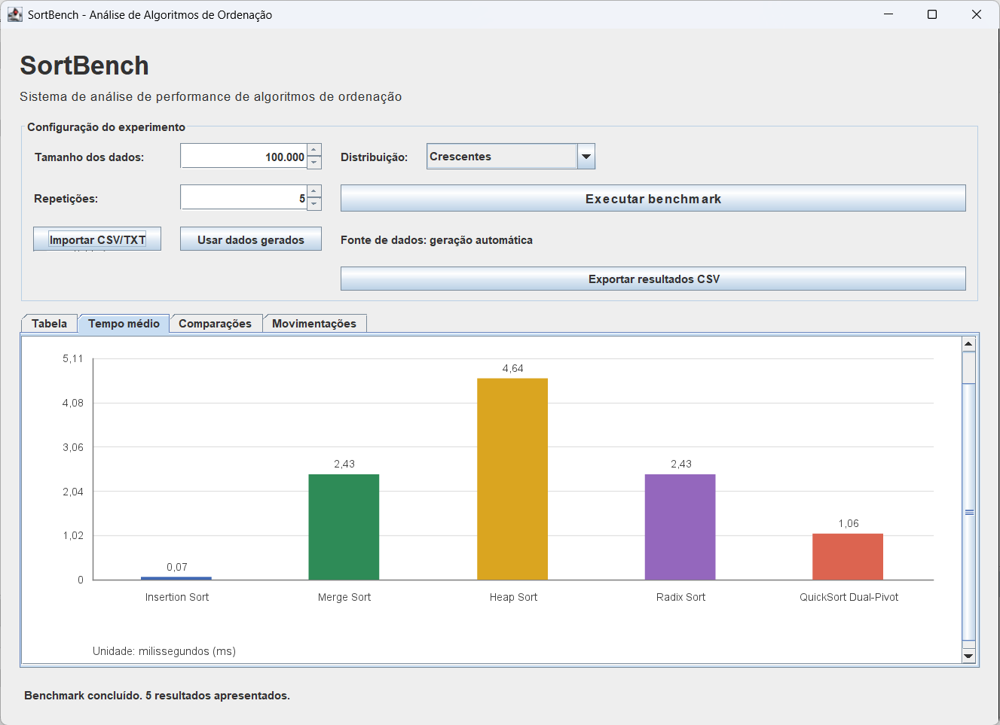
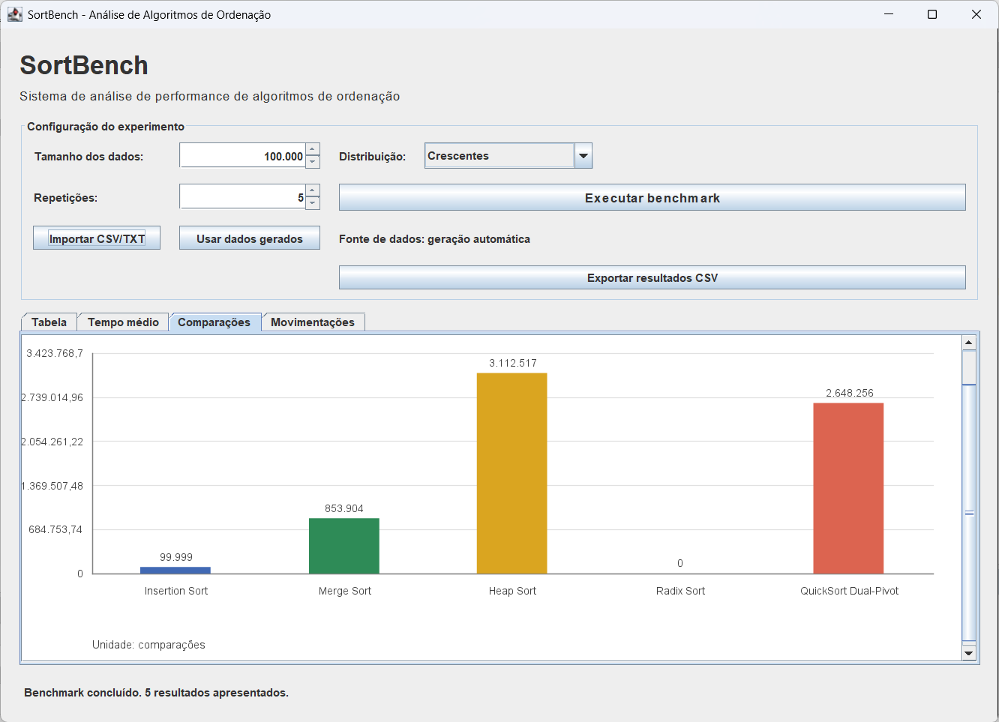
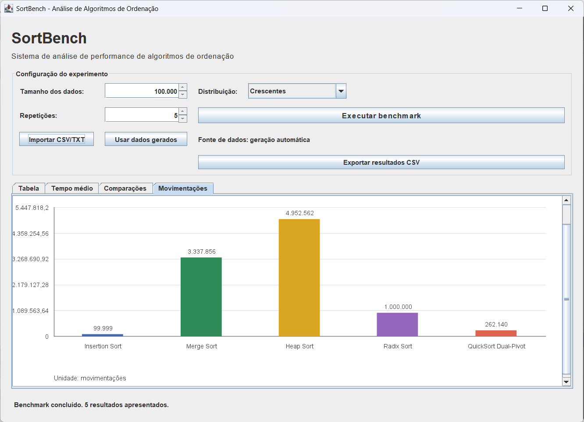

# SortBench

Sistema de análise de desempenho de algoritmos de ordenação desenvolvido em Java utilizando Java Swing.

O projeto tem como finalidade implementar e comparar diferentes algoritmos de ordenação, analisando seu comportamento por meio de métricas como tempo de execução, número de comparações, movimentações e trocas. Os resultados são apresentados em uma interface gráfica com tabelas e gráficos para facilitar a visualização e comparação dos dados.

## Demonstração


## Tecnologias utilizadas

- Java JDK 26;
- Java Swing;
- Java AWT;
- NetBeans IDE;
- Programação Orientada a Objetos;
- Algoritmos e Estruturas de Dados.

## Funcionalidades

- Geração de conjuntos de dados:
  - Aleatórios;
  - Crescentes;
  - Decrescentes;
  - Duplicados (40%).
- Configuração da quantidade de elementos;
- Configuração do número de repetições dos experimentos;
- Importação de arquivos CSV e TXT contendo números inteiros;
- Execução e comparação de cinco algoritmos de ordenação;
- Medição do tempo de execução;
- Contagem de comparações, movimentações e trocas;
- Apresentação dos resultados em tabelas;
- Visualização de gráficos de desempenho;
- Exportação dos resultados para arquivos CSV;
- Validação da ordenação e preservação dos elementos originais.

## Algoritmos implementados

- Insertion Sort;
- Merge Sort;
- Heap Sort;
- Quick Sort Dual-Pivot;
- Radix Sort.

## Objetivo

O principal objetivo deste projeto é aplicar, na prática, conceitos relacionados à disciplina de Estrutura de Dados, aprofundando os conhecimentos sobre algoritmos de ordenação e análise de desempenho.

Durante o desenvolvimento foram explorados conceitos como:

- Implementação de algoritmos de ordenação;
- Análise de complexidade e desempenho;
- Estruturas de dados;
- Programação Orientada a Objetos;
- Manipulação de vetores;
- Organização de projetos em pacotes;
- Desenvolvimento de interfaces gráficas com Java Swing;
- Medição e comparação de desempenho de algoritmos.

Além do aprendizado da linguagem Java, o projeto busca demonstrar como diferentes algoritmos se comportam diante de conjuntos de dados com tamanhos e distribuições distintas.

## Demonstração

### Tela principal


### Configuração dos experimentos


### Tabela de resultados


### Gráfico de tempo de execução


### Gráfico de comparações


### Gráfico de movimentações


## Como executar

### Requisitos

- Java JDK 26 ou superior;
- NetBeans IDE.

### Execução

1. Clone o repositório:

```bash
git clone https://github.com/Math-rujo/Projeto-SortBench.git
```

2. Abra o NetBeans IDE;
3. Selecione a opção para abrir um projeto existente;
4. Localize e abra a pasta `SortBench`;
5. Aguarde o carregamento do projeto;
6. Execute a classe principal `SortBench.java`.
